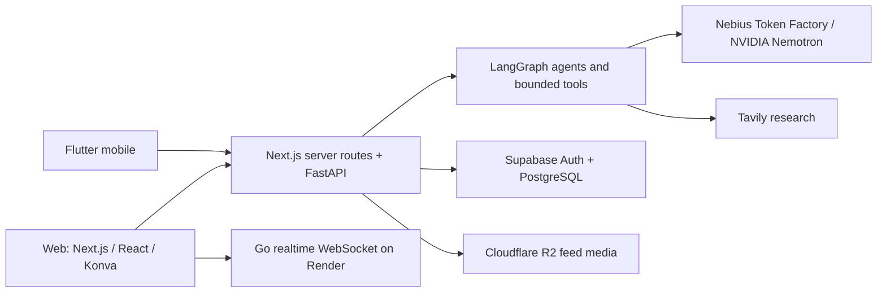

# ReasonAI

> **Nebius × NVIDIA evidence:** [evaluation methodology and verification plan](docs/hackathon-evidence/README.md). Live results are not claimed unless explicitly measured.

**Build Better Judgment.** An AI-native engineering workspace where developers **discover technical ideas, reason about architectures, build together, and master algorithms**—powered by **NVIDIA Nemotron on Nebius Token Factory**.

**[Try ReasonAI](https://www.reasonai.tech/login)** · **[Earlier product demo](https://www.youtube.com/watch?v=FoV2KkK72Xs)** (final hackathon video pending) · **[Devpost submission](https://devpost.com/software/reasonai)** · **[Technical architecture](docs/ARCHITECTURE.md)**

> AI can generate answers in seconds. ReasonAI helps engineers develop the judgment to decide what to build, why it works, and what to change.

## DSA execution and Android test build

[October 17 production verification](docs/dsa-v3/integration-20261017.md) documented a published catalog of **375 problems** with Run and Submit paths: **10 officially certified** and **365 provisionally graded**. Real 3Sum and Catalan Number production submissions generated saved verdicts and NVIDIA Nemotron Code Intelligence reports. These two runs do not establish a 375-problem end-to-end benchmark, and a provisional pass is not official `Accepted`.

Flutter v1.0.0 (2) supports the Feed and DSA learning, editor, submission history and AI review. See the [Android debug APK verification and distribution requirements](mobile/docs/release-readiness.md#verified-debug-delivery); a public APK URL and production-signed Android build are not yet verified.

### ReasonAI in action — real production capture

*Live production capture, October 11, 2026: System Design canvas during a **successful two-browser Live Share test**. This is evidence of manual realtime collaboration, **not** proof of successful AI canvas generation. [View the full before/after/reconnect sequence](docs/evidence/INDEX.md#real-screenshots--october-11-2026).*

## Judge quickstart — try it in five minutes

1. **Enter:** Open [ReasonAI's login page](https://www.reasonai.tech/login) and choose **Continue as Hackathon Judge**. No personal signup is needed.
2. **Discover:** In **Knowledge Feed**, select a story and ask ReasonAI for technical context or related developments. Inspect its cited sources.
3. **Reason + Build:** In **System Design**, ask for a scalability review, then request concrete canvas edits. Inspect the proposed components/edges and **accept or discard** them.
4. **Collaborate:** Start **Live Share**; open the invite in a second session, make a committed change, and confirm it appears in both views.
5. **Master:** Open a **DSA** problem, request a progressive hint, use local public-test **Run**, then try authenticated **Submit**. Inspect the persisted verdict, submission history and **Code Intelligence** review. Provisional passes are explicitly distinct from officially certified Accepted verdicts.

**What makes this different:** the model can reason over **actual canvas nodes and edges** and propose typed operations, but the application validates them and **only the engineer can accept changes**. ReasonAI is a workspace with real artifacts and state—not a generic chatbot wrapper.

## One product, four connected workflows

| Workflow | Working experience | AI contribution |
| --- | --- | --- |
| **Discover** | Engineering Knowledge Feed + Ask ReasonAI, web and Flutter | Nemotron enriches stories; Tavily enables grounded follow-up research |
| **Reason** | Architecture review, scalability analysis, bottleneck/failure reasoning | LangGraph/Nemotron reason over the **current canvas**; results refer to real diagram elements |
| **Build** | Editable Konva system-design canvas + Go WebSocket Live Share | AI proposes **validated, reviewable** node and edge operations; users control application |
| **Master** | 375-problem DSA catalog, Python editor, local public-test Run, authenticated sandbox Submit, Results Studio, history, Code Intelligence, hints and visual lessons | Nemotron-backed, contextual tutoring and post-submission code review; official and provisional judging remain distinguishable |

## More product screenshots

| DSA tutor: actual 3Sum hint | Knowledge Feed: actual story cards |
| --- | --- |
|  |  |

**Evidence caveat:** The hint UI worked, but the captured DSA visual walkthrough contained mathematical errors; the Feed displayed stories, but AI follow-up answer generation failed in the recorded runs. These images **do not** establish successful end-to-end AI outcomes. [See the evidence, failures, and original screenshots](docs/evidence/INDEX.md#real-screenshots--october-11-2026).

## Architecture at a glance

Three boundaries are deliberate:

- **AI is server-side:** Nebius credentials are never bundled into browser or Flutter clients; LangGraph bounds tool calls and persisted state.
- **AI proposals are not mutations:** typed contracts, state validation, and explicit human acceptance govern System Design edits.
- **Realtime is not model memory:** a Go WebSocket service synchronizes committed diagram operations; Supabase stores application and learning state.

Explore the [full architecture, flows, memory model, trust boundaries, deployment, and known limitations](docs/ARCHITECTURE.md).

## Why Nebius + NVIDIA matter

| Actual product path | Nemotron's role |
| --- | --- |
| Knowledge refresh | Structured enrichment of retrieved stories **before** they appear in the feed |
| Ask ReasonAI | Story-context answers and model-selected bounded research tools |
| DSA agent | Progressive tutoring, reasoning, and structured visual/tool responses |
| System Design agent | Architecture review, analysis and reviewable canvas proposals |

System Design supports **Lightning**, **Super**, and **Ultra**, with **Auto** routing that can escalate qualifying turns from Super to Ultra. See [verified model configuration and implementation boundaries](HACKATHON_SUBMISSION.md). No claim is made that each model tier outperforms the others without a controlled evaluation.

## Technical evidence and reproducibility

**[Hackathon Evidence Hub](docs/evidence/INDEX.md)** — claims-to-code mapping, [live evidence capture guide](docs/evidence/CAPTURE_RUNBOOK.md), [fixed evaluation protocol](docs/evidence/EVALUATION_PROTOCOL.md), and [run record template](docs/evidence/RUN_RECORD_TEMPLATE.md). Quantitative results remain unpublished until real trials are completed and reviewed.

These links point to **existing implementation or tests**. They are not presented as measured benchmark results.

| What to inspect | Evidence in this repository |
| --- | --- |
| Nebius integration, model routing, hackathon changes | [HACKATHON_SUBMISSION.md](HACKATHON_SUBMISSION.md) · [System Design reasoning documentation](web/docs/system-design-reasonai.md) |
| Safe AI canvas suggestions and recovery | [Proposal contracts and lifecycle](web/docs/reasonai-proposal-recovery.md) · [AI browser tests](web/e2e/reasonai.spec.ts) |
| Multi-user ordering, replay and reconnect | [Go realtime documentation](realtime/README.md) · [Room test cases](realtime/internal/room/room_test.go) |
| Knowledge enrichment and feed delivery | [Ingestion pipeline](backend/docs/knowledge-shorts.md) · [Knowledge API tests](backend/tests/knowledge/test_api.py) |
| LangSmith wiring, tracing contracts | [LangSmith integration tests](web/e2e/langsmith.spec.ts) |
| Setup and test commands | [Development and Verification](docs/DEVELOPMENT.md) |

**Evidence status:** implementation and automated test *sources* are available; this README does **not** claim that all tests passed in a fresh run or that agent quality, latency, load capacity, or user impact have been benchmarked. Those results require dated execution artifacts and an explicit evaluation protocol.

## What was added during the hackathon?

ReasonAI extends an **existing** engineering learning project. The hackathon implementation introduced Nebius/Nemotron-backed AI workflows, LangGraph agents, reviewable canvas proposals, contextual DSA tutoring, Knowledge Feed enrichment and research, enhanced collaboration, model selection, and mobile experiences. The [hackathon submission record](HACKATHON_SUBMISSION.md) identifies the concrete changes and reproducible entry points; repository history provides the chronological record.

## Developer guide

- **[Set up the application](docs/DEVELOPMENT.md#local-development):** backend, Go realtime service, Next.js web client, Flutter mobile and required configuration.
- **[Run verification](docs/DEVELOPMENT.md#verification):** typecheck, lint, build, browser tests, backend checks and realtime tests. Some E2E tests need additional services and credentials.
- **[Inspect architecture](docs/ARCHITECTURE.md):** detailed flows, memory/personalization, Knowledge lifecycle, collaboration semantics, security and deployment.
- **Feature docs:** [DSA](web/docs/dsa-workspace.md) · [System Design](web/docs/system-design-reasonai.md) · [Knowledge Feed](web/docs/knowledge-feed.md) · [Mobile](mobile/README.md).

**Project stack:** Next.js, React, TypeScript, Konva, Flutter, Dart, FastAPI, Python, LangGraph, Go, WebSockets, Supabase/PostgreSQL, Cloudflare R2, Tavily, LangSmith, Nebius Token Factory, NVIDIA Nemotron, Vercel, Google Cloud Run, Render.

## What is implemented vs. planned

**Implemented:** a 375-problem published DSA catalog with authenticated Run and Submit access, a Pyodide browser Run path, sandbox-backed submissions, Results Studio, saved submission history, AI Code Intelligence and contextual tutoring; System Design review/typed canvas proposals; Nemotron-backed Knowledge enrichment and bounded research tools; single-instance Go realtime collaboration; and Flutter Knowledge/DSA workflows including mobile editing and submission/report surfaces. See [October 17 production evidence](docs/dsa-v3/integration-20261017.md) and [mobile release gates](mobile/docs/release-readiness.md).

**Not presented as implemented or verified:** distributed durable realtime rooms, learned behavioral recommendation models, full System Design editing on mobile, GitHub-to-canvas generation, an external MCP editing interface, independently certified judging for all 375 problems, or a signed Android/iOS store release. Ten problems have existing official certificates and 365 have **provisional** Submit grading; success on a provisional path is `provisional_pass`, not official `Accepted`. See [current vs. future architecture](docs/ARCHITECTURE.md#current-vs-next-architecture).

---

**ReasonAI — Build Better Judgment.** [Try it](https://www.reasonai.tech/login) · [Demo](https://www.youtube.com/watch?v=FoV2KkK72Xs) · [Devpost](https://devpost.com/software/reasonai)
