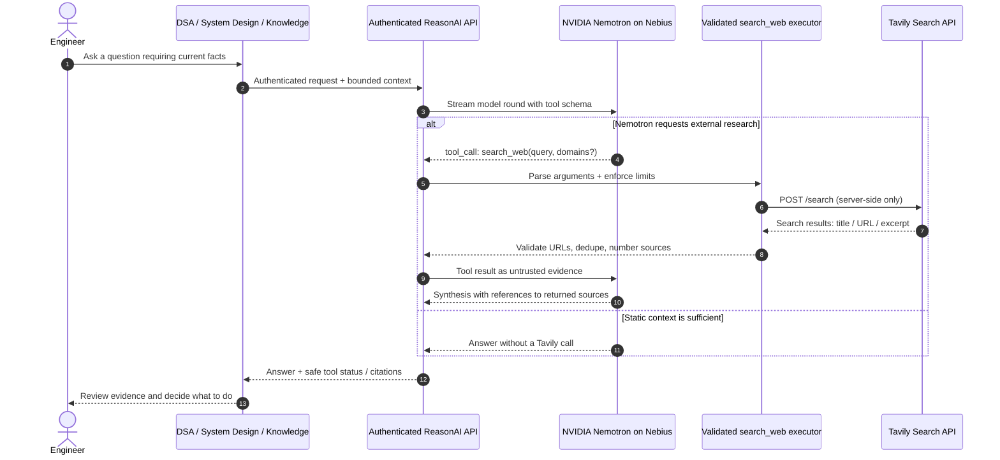

# ReasonAI

**Build Better Judgment.** When a developer passes the visible tests but fails a real submission—or has an architecture diagram but cannot see its failure modes—another generic AI answer is not enough. **ReasonAI connects executable evidence, editable architecture artifacts, and NVIDIA Nemotron reasoning** so engineers can investigate what failed and decide what to change.

[**Launch ReasonAI**](https://www.reasonai.tech/login) · [**Watch product demo**](https://www.youtube.com/watch?v=FoV2KkK72Xs) *(earlier demo; final hackathon video pending)* · [**Devpost**](https://devpost.com/software/reasonai) · [**Architecture details**](docs/ARCHITECTURE.md)

### Architecture first — where code ends and reasoning begins


**Not a prompt wrapper:** Nemotron **reasons, teaches, analyzes, and proposes**. Deterministic code **runs tests, grades submissions, validates typed operations, orders real-time updates, and persists authoritative state**. AI-generated canvas changes require human approval. All Nebius credentials remain server-side. [Inspect the actual flows and trust boundaries →](docs/ARCHITECTURE.md)

## A concrete failure: visible tests are not the whole truth

| Before: ordinary local confidence | After: evidence-backed reasoning in ReasonAI |
| --- | --- |
| A deliberately overfitted **3Sum** implementation passed **9/9 visible tests**. That did **not** establish correctness. | A real sandbox-backed **Submit** returned **`wrong_answer`** on the provisional judging path; the result was saved with submission history. |
| The learner has a green local result but no reliable hidden-case verdict. | **NVIDIA Nemotron Super** produced a persisted Code Intelligence review associated with that exact submission. |

This is a [documented October 17 production run](docs/dsa-v3/integration-20261017.md), **not** evidence that a learner subsequently solved the problem or improved interview performance. Trusted judging is deterministic; the model's explanation is advisory.


*Illustrative animated sequence of the verified October 17 flow—not a UI recording or proof of learning improvement.*

### Real product, not a concept render


*October 11 production capture: manual canvas changes synchronized across two browser sessions, including reconnect verification. This image does not demonstrate AI-created canvas changes. [See original captures, runs, and failures →](docs/evidence/INDEX.md#real-screenshots--october-11-2026)*

## Why Nebius + NVIDIA Nemotron (and where Tavily fits)

Nebius **Token Factory** is ReasonAI's server-side model inference boundary. The application uses its OpenAI-compatible interface for streamed agent turns, structured tool calls, and offline Knowledge enrichment—not for execution or trusted judging.

| Routing / component | Exact implemented role | Engineering trade-off |
| --- | --- | --- |
| **Nemotron Lightning** · `nvidia/Nemotron-3_5-Lightning` | Explicit lightweight model preference in **System Design** | Gives engineers a smaller-tier choice; no public latency or accuracy superiority claim |
| **Nemotron Super** · `nvidia/nemotron-3-super-120b-a12b` | Default ReasonAI model; DSA tutoring, Code Intelligence, story reasoning, System Design | Baseline general reasoning path; a real Code Intelligence production run used Super |
| **Nemotron Ultra** · `nvidia/Nemotron-3-Ultra-550b-a55b` | Explicit deeper-reasoning option in **System Design** | Available for more demanding turns; quality/cost benefit has not been independently benchmarked |
| **Auto routing** | System Design starts with **Super** and can escalate a qualifying turn to **Ultra** | Server records selected tier, actual models used and escalation rather than trusting generated text |
| **Tavily** | News discovery for Knowledge ingestion; bounded `search_web` for current facts and cited research | Fresh external evidence complements static model knowledge; citations don't guarantee factual correctness |

**Why this architecture matters:** The Knowledge Feed performs discovery, deduplication, image validation, Nemotron enrichment and persistence **offline**. Its normal online read/ranking path stays deterministic instead of paying for live model generation on every scroll. DSA Run uses **Pyodide in the browser**; trusted Submit uses the sandbox-based judge, not an LLM verdict. [Model IDs, sponsor integration, and hackathon-period changes →](HACKATHON_SUBMISSION.md) · [Technical evaluation protocol →](docs/evidence/EVALUATION_PROTOCOL.md)

## Tavily tool calls — exact execution path

**Two complementary integrations, not a search box bolted onto chat:** Nemotron may **request external evidence during a reasoning turn**; separately, the Knowledge refresh job **discovers stories ahead of time**. The model never receives a Tavily API key and cannot directly fetch arbitrary pages from the user's browser.



**Example model-selected function arguments (illustrative, matching the System Design contract):**

```json
{
  "query": "Amazon SQS standard queues message ordering guarantees",
  "domains": ["docs.aws.amazon.com"]
}
```

Nemotron emits these as a `search_web` tool call. The server validates and sanitizes the arguments before issuing a **real Tavily HTTP request**, configured as:

```json
{
  "query": "Amazon SQS standard queues message ordering guarantees",
  "search_depth": "basic",
  "max_results": 3,
  "include_answer": false,
  "include_raw_content": false,
  "include_images": false,
  "auto_parameters": false,
  "include_domains": ["docs.aws.amazon.com"]
}
```

*Example payload, not a captured production request or a search result.* This is a server-side `POST https://api.tavily.com/search` with `TAVILY_API_KEY`; the key is never shipped to web/mobile clients. The application consumes **source titles, URLs and bounded excerpts**, not a generated Tavily answer. [Inspect the real request builder →](web/src/lib/tavily/search.ts) · [Tool schema and query validation →](web/src/features/system-design/reasonai/research.ts)

### Where each Tavily call is used

| Entry point | Trigger and actual tool behavior | Result |
| --- | --- | --- |
| **System Design — `/api/reasonai/chat`** | Nemotron selects `search_web` for fresh provider limits, service capabilities, deprecations, pricing or documentation. No search is required for ordinary architecture reasoning. | Up to **2 searches / request**, **3 results / search**, **6 unique sources**; retrieved evidence can inform a sourced explanation or an architecture overlay. |
| **DSA V2 — `/api/reasonai/dsa/chat`** | The LangGraph tutor chooses `search_web` when a question requires external problem/technical context; otherwise it can tutor without search. | Up to **5 public URLs**, **1,500-character snippets**, bounded tool rounds; external evidence is not durable learner memory. |
| **DSA linked-source fallback** | When exact external problem requirements are necessary, the legacy/source-context path can try **Tavily Extract**, then source-domain search, then broader search. | Prefers the exact linked problem over similarly titled but different problem statements; does **not** send private code, notes or history to Tavily. |
| **Knowledge story chat — `/api/reasonai/knowledge/chat`** | The model chooses `search_web` for “more like this”, recent related developments or external verification, when story context is insufficient. | At most **2 tool rounds** and **3 external cited URLs**; the final answer is checked against the actual story/search URL allowlist. |
| **Knowledge refresh job** | A separate worker searches Tavily using `topic: "news"`, `time_range: "week"` and `search_depth: "basic"` alongside Hacker News discovery. | URL canonicalization → dedupe and recency gates → image validation → **Nemotron structured enrichment** → PostgreSQL + R2. Normal feed reads make **no Tavily or model call**. |

### Bounded execution and evidence integrity

- **Privacy:** server-only credentials; public-technology queries are filtered to reject secrets, opaque tokens, private diagram descriptions and copied conversation content on the System Design path.
- **Cost / latency:** Tavily online searches use **basic** depth, at most **3 results each**, a **7-second search deadline**, and a **128 KiB response cap** in the shared search adapter. External research is skipped when unnecessary.
- **Source safety:** only normalized public HTTP(S) URLs are accepted; duplicates, malformed URLs and suspicious credential-bearing content are rejected. Retrieved text is **untrusted data**, never instructions.
- **Failures:** unavailable or empty results become a safe tool status; agents must acknowledge unsupported current facts rather than inventing sources. Model synthesis can still fail after a successful search—both stages require independent verification.
- **Observability:** LangSmith tool spans and structured runtime events distinguish `tool.started`, `tool.completed`, `tool.failed`, source emission, and final answer completion. Their existence is not a claimed end-to-end reliability benchmark.

**Code and verification:** [System Design executor](web/src/lib/reasonai/server/langgraph/system-design/tools.ts) · [DSA search implementation](web/src/features/dsa/reasonai/web-context.ts) · [Knowledge chat orchestration](web/src/features/feed/reasonai.ts) · [Tavily discovery adapter](backend/src/recallstack/modules/knowledge/infrastructure/providers/tavily.py) · [Recorded Knowledge research failure](docs/evidence/runs/2026-10-11/KNOW-01/record.md). The diagram and example are **implementation explanations**, not evidence of a successful production search-to-answer run.


## Judge quickstart — try it in five minutes

**No install or personal signup required.** Open **[ReasonAI](https://www.reasonai.tech/login)** and choose **Continue as Hackathon Judge**.

1. **First insight:** Open **System Design**, ask for a bottleneck or failure review of the current architecture, and inspect the analysis against actual canvas nodes and edges.
2. **See the safety boundary:** Request canvas changes. Review any proposed operations and choose whether to **accept or discard** them. The model cannot silently edit a shared document.
3. **Test the learning loop:** Open **DSA → 3Sum**, request a progressive hint, then use local **Run** and authenticated **Submit**. Review the returned verdict, history and Code Intelligence report.
4. **Explore collaboration and freshness:** Use **Live Share** with a second browser to test synchronized canvas edits, or open a Knowledge story and ask for recent related developments using Tavily-backed research.

**Try this prompt in System Design:** `Review this architecture for a single point of failure. Identify affected nodes and propose reviewable changes.`

These are suggested evaluation steps, **not** a promise of a successful AI result within 30 seconds; provider latency and content quality vary. For recorded outcomes and known gaps, use the [Evidence Hub](docs/evidence/INDEX.md).

## What doesn't work yet — and what we learned

| Known limitation / evidence boundary | Engineering implication |
| --- | --- |
| **DSA certification:** the last published October 17 audit verified **375 accessible Run/Submit paths**, but only **10 officially certified** and **365 provisionally graded**. | A `provisional_pass` is never displayed as official `Accepted`. Later certification work requires a fresh documented audit. |
| **AI visual correctness:** an October 11 DSA walkthrough rendered successfully but included a mathematically invalid triplet. | Typed/schema-valid visuals are **not** automatically factually correct; content-level checking remains necessary. |
| **Research failures:** the October 11 Knowledge story-chat run did not complete a user-visible answer despite separate evidence of server-side searches. | Tool execution is not the same as a grounded answer delivered to the user; end-to-end reliability must be measured. |
| **Canvas persistence:** a production Nemotron-generated proposal was saved as **pending**, but that test did not verify its acceptance or standalone canvas restoration after refresh. | Proposed edits, applied edits and durable canvas state must be tested independently. |
| **Realtime scaling:** Go room operations, ACKs, replay and reconnect were exercised in a single-instance topology. | Cross-instance durable rooms and distributed failure recovery are **not** claimed. |
| **Mobile distribution:** an Android debug build and unsigned iOS compilation were documented; store-signing and real-device release gates remain separate. | A test build is not an officially distributed app. |
| **Security and impact:** older Supabase advisor findings and the absence of a controlled learning-impact study remain open evidence gaps. | Never substitute implementation complexity or signup counts for a completed security audit or proven learner outcomes. |

These are **dated observations, not assertions that every issue still reproduces today**. We preserve failures instead of rewriting history after fixes. See [run records and verification scope](docs/evidence/INDEX.md), [mobile release gates](mobile/docs/release-readiness.md), and [current versus future architecture](docs/ARCHITECTURE.md#current-vs-next-architecture).

## Reproduce, inspect, verify

**Fastest reproduction:** use the live **judge path above**; it uses the hosted backend and requires no local secrets.

For a local development environment, the web, Python API, database and Go realtime service require independent configuration. The minimal bootstrap is:

```bash
git clone https://github.com/saksham60/recallstack.git
cd recallstack

# In separate terminals, follow each component's documented setup:
# docs/DEVELOPMENT.md
# web/README.md · backend/README.md · realtime/README.md
```

Server-side keys include `NEBIUS_API_KEY` and `TAVILY_API_KEY`, with `REASONAI_BASE_URL=https://api.tokenfactory.nebius.com/v1`. Database/Supabase settings, authentication configuration and other component-specific variables are also required. Copy the supplied `.env.example` files; **never commit populated credentials**. [Exact shell commands, environment variables, local services, and verification suites →](docs/DEVELOPMENT.md).

### Inspectable engineering evidence

| Claim | Source of evidence |
| --- | --- |
| Nemotron agent orchestration and tier routing | [Hackathon technical submission](HACKATHON_SUBMISSION.md) · [System Design agent](web/docs/system-design-reasonai.md) |
| Deterministic judging and saved code reviews | [DSA integration run](docs/dsa-v3/integration-20261017.md) |
| Typed AI canvas proposals and safety checks | [Proposal lifecycle](web/docs/reasonai-proposal-recovery.md) · [browser tests](web/e2e/reasonai.spec.ts) |
| Ordered collaboration and replay | [Realtime service](realtime/README.md) · [room tests](realtime/internal/room/room_test.go) |
| Tavily ingestion and deterministic feed ranking | [Knowledge pipeline](backend/docs/knowledge-shorts.md) · [Knowledge API tests](backend/tests/knowledge/test_api.py) |
| Raw successes, failed attempts and evidence gaps | [Hackathon Evidence Hub](docs/evidence/INDEX.md) |

**Evidence policy:** Having source code and tests is not the same as a dated passing production benchmark. Model quality, token economics, load capacity, end-to-end latency, and user learning outcomes are **not** claimed as independently measured unless a linked evaluation run establishes them. [Evaluation methodology →](docs/hackathon-evidence/README.md)

## Built during the hackathon

ReasonAI predates the August 26, 2026 submission window. The major work since then includes **Nebius/Nemotron-based LangGraph agents, bounded Tavily tools, reviewable architecture proposals, tiered System Design models, a Go collaboration service, Knowledge enrichment, contextual DSA feedback, persistent learning state and Flutter clients**. The [hackathon submission record](HACKATHON_SUBMISSION.md) and Git history distinguish this work from the pre-existing product.

**ReasonAI — Build Better Judgment.** [Live app](https://www.reasonai.tech/login) · [Devpost](https://devpost.com/software/reasonai) · [Full architecture](docs/ARCHITECTURE.md) · [MIT license](LICENSE)
