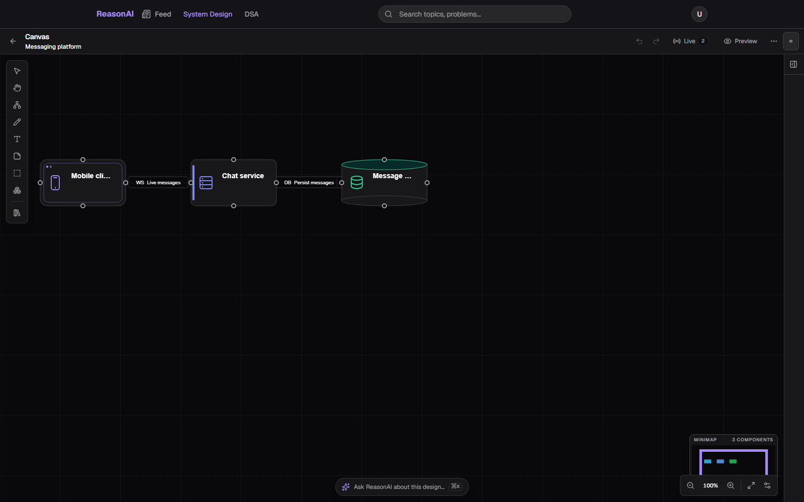
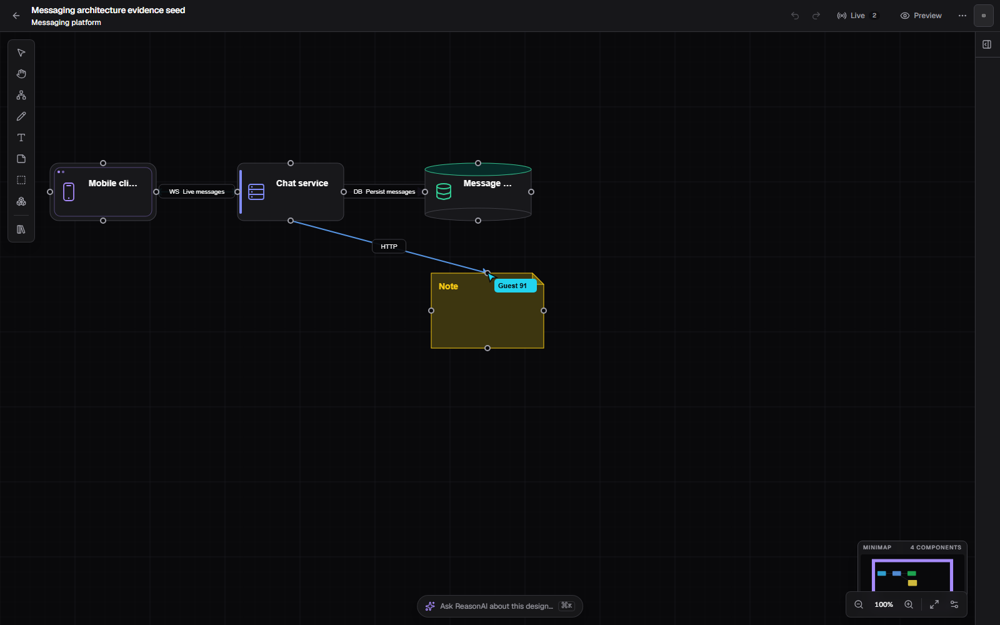
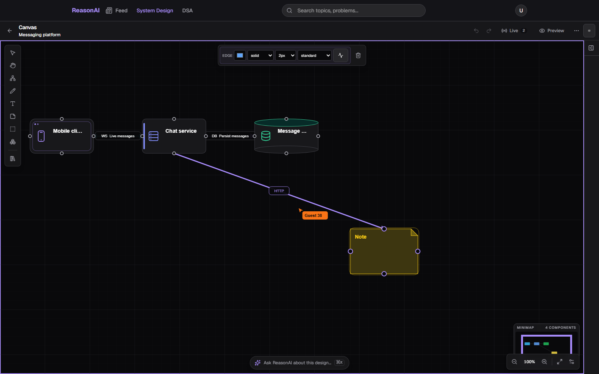
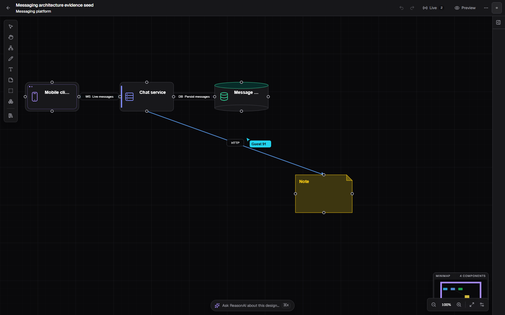
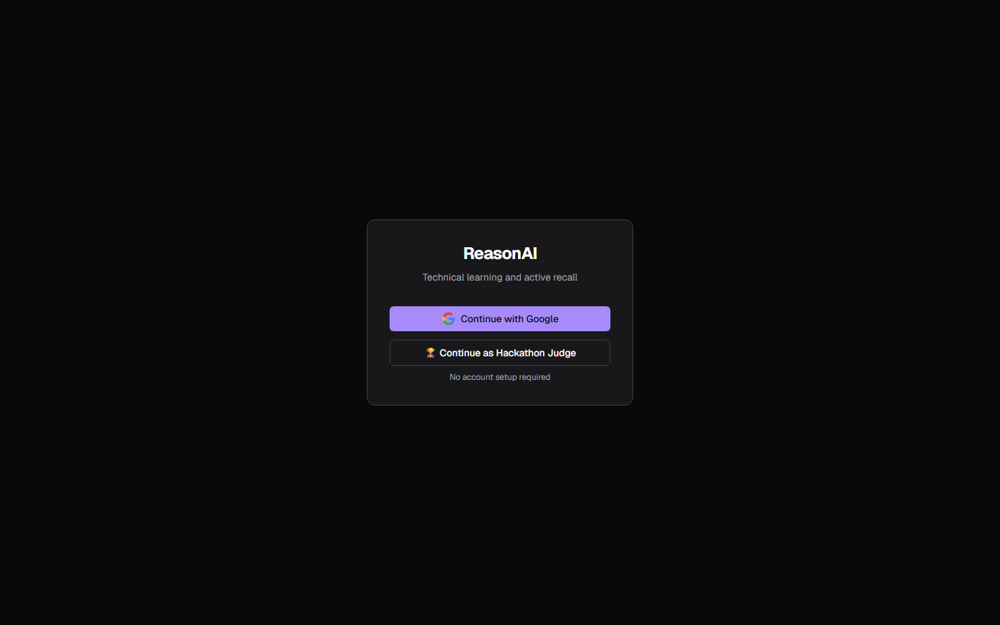
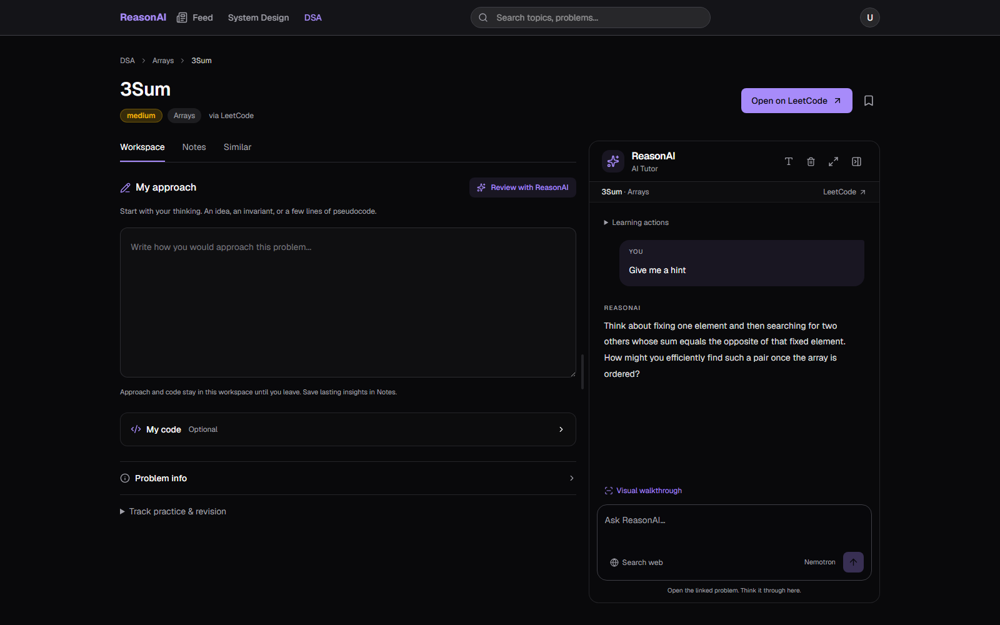
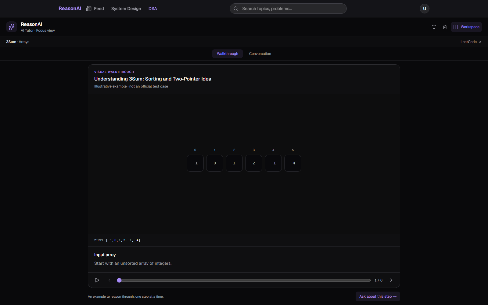
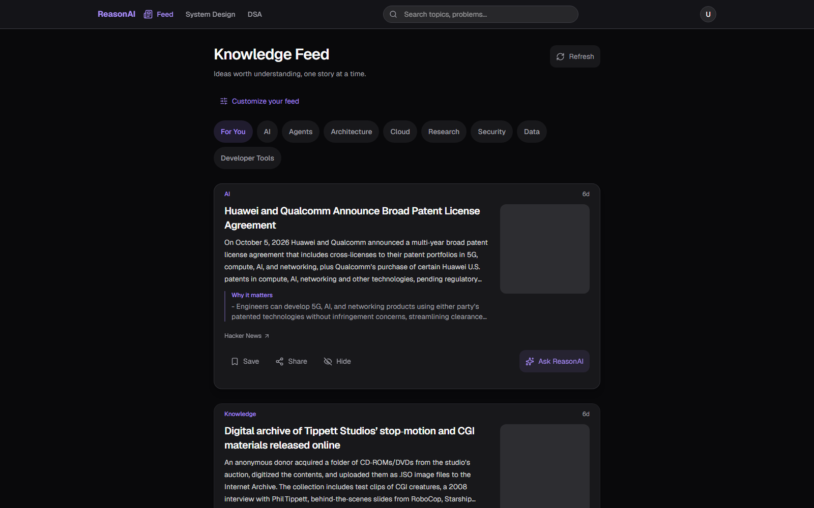
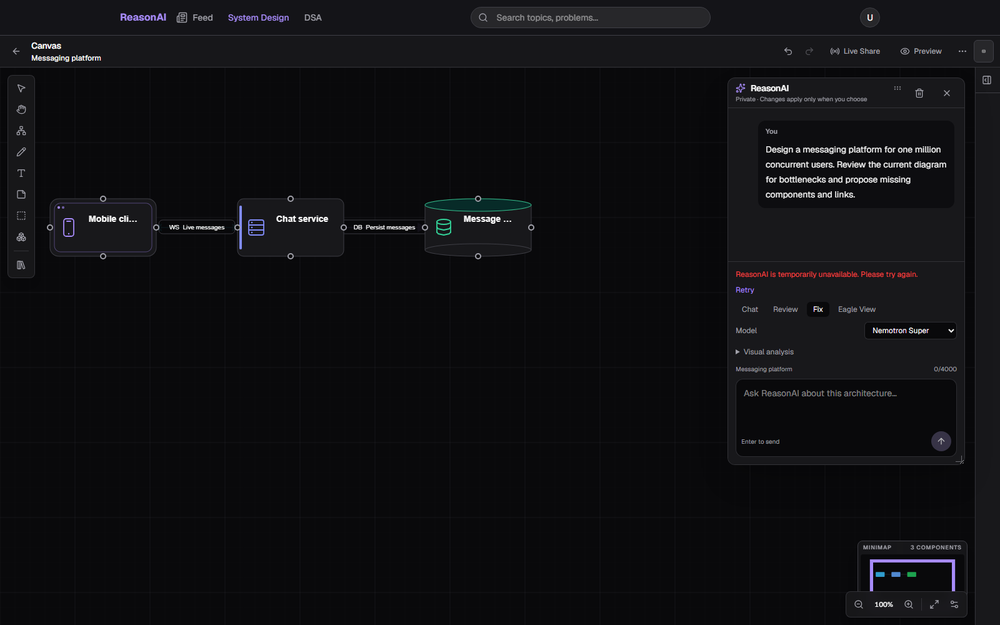
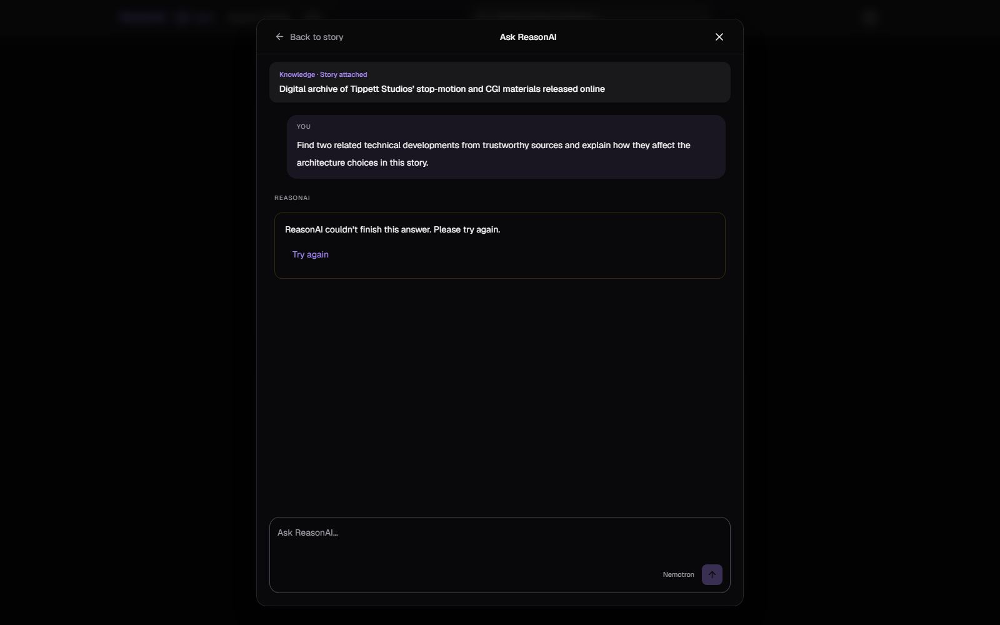

# ReasonAI — Hackathon Evidence Hub

> **Status (2026-10-11 UTC):** Live judge access and two-browser collaboration were captured; a later **live System Design AI proposal and its pending state are verified in production**. Acceptance/reload and Knowledge research still have evidence gaps. Earlier failure records remain published. Tests show implementation behavior, not proof of a production outcome.

**Project:** [ReasonAI](https://www.reasonai.tech) · [3-minute demonstration](https://www.youtube.com/watch?v=FoV2KkK72Xs) · [Devpost](https://devpost.com/software/reasonai) · [Judge walkthrough](../../README.md#judge-quickstart--try-it-in-five-minutes) · [Full architecture](../ARCHITECTURE.md).

## Real screenshots — October 11, 2026

These are **actual Chromium captures of the production application**, collected by Codex. Screenshots establish what was visible in those specific tested sessions; see associated run records for observed events, limitations, and provenance. **The later 2026-10-11 System Design production success is documented by logs and database verification, not by a publicly archived same-run screenshot.**

### Live collaboration — verified UI synchronization

| Initial diagram in browser A | Same room synchronized in browser B |
| --- | --- |
|  |  |

| Browser A receives the node move from B | Browser B after reconnecting |
| --- | --- |
|  |  |

**Observed:** four nodes and three connections converged across two browser contexts, including after reloading browser B. This does not prove distributed scaling, ACK protocol metrics, or AI-driven edits. [Full collaboration run](runs/2026-10-11/COLLAB-01/record.md).

### Other real product screens

| Judge entry screen — login passed | DSA 3Sum tutor — hint appeared |
| --- | --- |
|  |  |

| DSA visual walkthrough — renders, but accuracy failed | Knowledge Feed — story cards displayed |
| --- | --- |
|  |  |

**Limitations:** The DSA visual tool rendered but its generated explanation included an invalid zero-sum triplet. Knowledge Feed displayed stories but did not generate a completed research answer in the recorded runs. [DSA run](runs/2026-10-11/DSA-01/record.md) · [Feed run](runs/2026-10-11/KNOW-01/record.md).

### Later live System Design proposal — verified server-side and in PostgreSQL

**New verified production run:** [SD-LIVE-01 — fresh-canvas AI proposal](runs/2026-10-11/SD-LIVE-01/record.md) (2026-10-11 13:32 UTC, deployment `462e72f33f4a56de4f61302b4fa73b8af767a72c`).

- **Nemotron Super through the production System Design runtime:** `Auto` selected `super`; `propose_canvas_changes` completed on attempt **1** (tool reported 3 ms).
- **Validated proposal:** 5 new nodes (**Web Application, API Gateway, Backend Service, PostgreSQL Database, Redis Cache**) and 4 correctly directed edges: Web → Gateway → Backend → PostgreSQL/Redis. The nine operations were independently counted from the saved database proposal.
- **Durable pending proposal:** Vercel emitted `reasonai.run.completed` / `taskOutcome: awaiting_approval` (reported execution **23,499 ms**, **one** run). Supabase showed run status `completed`, conversation-state version **1**, `pendingProposal.status=pending`, and **9 saved operations**. App trace ID: `11262090-7c7a-45e0-b724-503cd585549f`.
- **Remaining gap:** **0** recorded approval actions. The user reported that the **standalone canvas disappeared after refresh**. In standalone mode the editor's document-save hook is disabled without a saved problem, so this test does **not** verify Accept All or durable diagram restoration. The persisted *pending AI proposal* is not the same as an applied/persisted canvas.

This later, simpler fresh-canvas request is **not** a rerun or a pass for [SD-01's million-user messaging prompt](runs/2026-10-11/SD-01/record.md). Earlier failures remain preserved below. No end-to-end acceptance result or performance benchmark is claimed.

### Captured failures — not presented as success

| System Design AI proposal request failed | Knowledge research answer failed |
| --- | --- |
|  |  |

These pictures show **failure handling**, not completed AI proposals or grounded research. [System Design run](runs/2026-10-11/SD-01/record.md) · [Feed run](runs/2026-10-11/KNOW-01/record.md).

## Evidence coverage

| Area | Inspectable implementation | Observed result and remaining gap |
| --- | --- | --- |
| **Judge access** | [Judge walkthrough](../../README.md#judge-quickstart--try-it-in-five-minutes) | [Fresh production browser sign-in passed](runs/2026-10-11/JUDGE-01/record.md). |
| **Sponsor integration** | [Nebius/Nemotron runtime map](../../HACKATHON_SUBMISSION.md), [System Design agent details](../../web/docs/system-design-reasonai.md) | [Direct local Nemotron Super and Tavily probes](runs/2026-10-11/provider-probe.json) returned HTTP 200; **separately**, [production SD-LIVE-01](runs/2026-10-11/SD-LIVE-01/record.md) recorded a real `super` model selection and successful canvas tool call. The full upstream provider model ID for **that run** was not independently exported; code maps Super to `nvidia/nemotron-3-super-120b-a12b`. |
| **System Design AI** | [Typed proposals and recovery](../../web/docs/reasonai-proposal-recovery.md), [browser tests](../../web/e2e/reasonai.spec.ts) | [SD-01](runs/2026-10-11/SD-01/record.md) **failed** (two earlier live attempts). In a separate later [SD-LIVE-01 production run](runs/2026-10-11/SD-LIVE-01/record.md), one validated **5-node, 4-edge** AI proposal was generated and **persisted as pending** in PostgreSQL. **Accept All, proposal transitions and standalone editor restore remain unverified/failed.** |
| **DSA tutoring** | [DSA workspace](../../web/docs/dsa-workspace.md), [agent tests](../../web/e2e/dsa-reasonai-agent.spec.ts) | [Live 3Sum hint and schema-valid visuals](runs/2026-10-11/DSA-01/record.md) captured. Visual content quality failed: one skipped a pointer state, another named an invalid triplet. Production model ID was not surfaced. |
| **Knowledge Feed** | [Pipeline](../../backend/docs/knowledge-shorts.md), [API tests](../../backend/tests/knowledge/test_api.py) | [Three live app requests failed](runs/2026-10-11/KNOW-01/record.md). Browser capture showed no tool events or completed answer. Separately inspected production Vercel logs **did** record successful server-side `search_web` executions, but the final answer failed and no user-visible citation was produced; a sanitized server-side trace is not yet published. |
| **Realtime collaboration** | [Go service](../../realtime/README.md), [room tests](../../realtime/internal/room/room_test.go) | [Two-session UI convergence and reconnect](runs/2026-10-11/COLLAB-01/record.md) observed with a new node, connection, and node move. Protocol ACK IDs and production topology were not captured. |
| **Tracing / observability** | [LangSmith integration tests](../../web/e2e/langsmith.spec.ts) | [Mocked tracing tests passed](runs/2026-10-11/TESTS.md). A separately inspected earlier LangSmith model span showed HTTP 200 and partial tool-call arguments, but no sanitized live trace file is archived. [SD-LIVE-01](runs/2026-10-11/SD-LIVE-01/record.md) records its app trace ID plus a `langsmith.flush.completed` event; flush alone does not verify a retrievable LangSmith span for this success run. |
| **Automated verification** | [Documented commands](../DEVELOPMENT.md#verification) | [Scoped results](runs/2026-10-11/TESTS.md): 166 web state tests, 46 backend tests, and typecheck passed. Browser suite server gate timed out; Go was not installed. |
| **User impact** | [Product demonstration](https://www.youtube.com/watch?v=FoV2KkK72Xs) | No consented user task study or measured impact. |

## 2026-10-11 capture summary

The production judge flow worked in a fresh browser. DSA generated real tool and visual events, but its trace content failed quality checks. Two-client collaboration produced converged screenshots. The earlier [SD-01](runs/2026-10-11/SD-01/record.md) live attempts failed; a later, separate [SD-LIVE-01](runs/2026-10-11/SD-LIVE-01/record.md) produced a valid 9-operation AI proposal, and PostgreSQL saved it as **pending**. Standalone canvas refresh did not preserve the diagram; no approval event was recorded. Knowledge research executed server-side web searches according to Vercel logs but returned `INCOMPLETE_RESPONSE` rather than a completed cited answer. The [test report](runs/2026-10-11/TESTS.md) labels fixture-based tests separately from live tasks.

## Capture and reporting rules

1. Follow the [capture runbook](CAPTURE_RUNBOOK.md), [fixed evaluation protocol](EVALUATION_PROTOCOL.md), and [run record template](RUN_RECORD_TEMPLATE.md). Do not generate mock screenshots as evidence.
2. Store reviewed records under `docs/evidence/runs/YYYY-MM-DD/<case-id>/` and screenshots under `docs/evidence/screenshots/`.
3. Label live model calls, unit/E2E tests, direct provider probes, and subjective scoring separately. Include failures and all attempts.
4. Report latency, cost, throughput, win rate, or accuracy only with a measurement source and sample size. The messaging prompt is an architecture exercise, not a million-user load test.
5. Keep credentials, cookies, private rooms, identifying data, and private model reasoning out of public artifacts. Record only sanitized excerpts and public source URLs.

**Next evidence milestone:** capture a **saved problem-diagram** acceptance (Accept All/Discard), its verified proposal-event receipt and refresh-persistent canvas; capture source-backed Knowledge research; archive appropriately sanitized production LangSmith provenance. Standalone canvas save/restore remains a separate known limitation.
