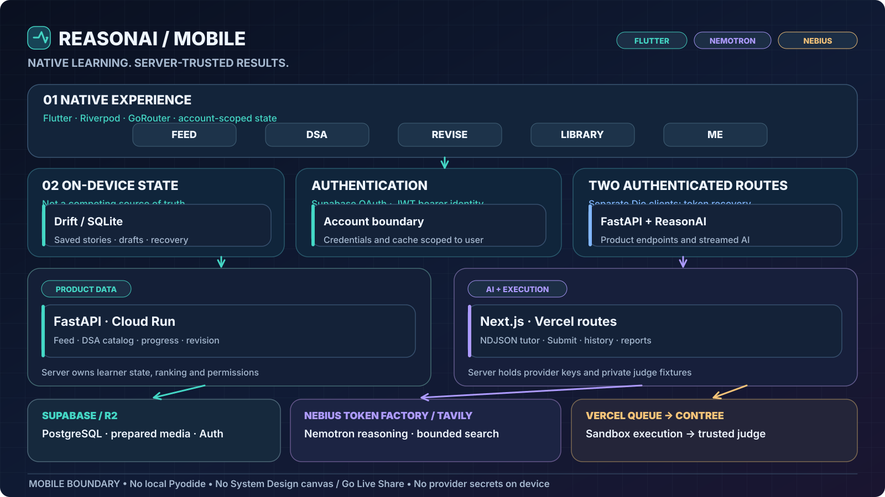
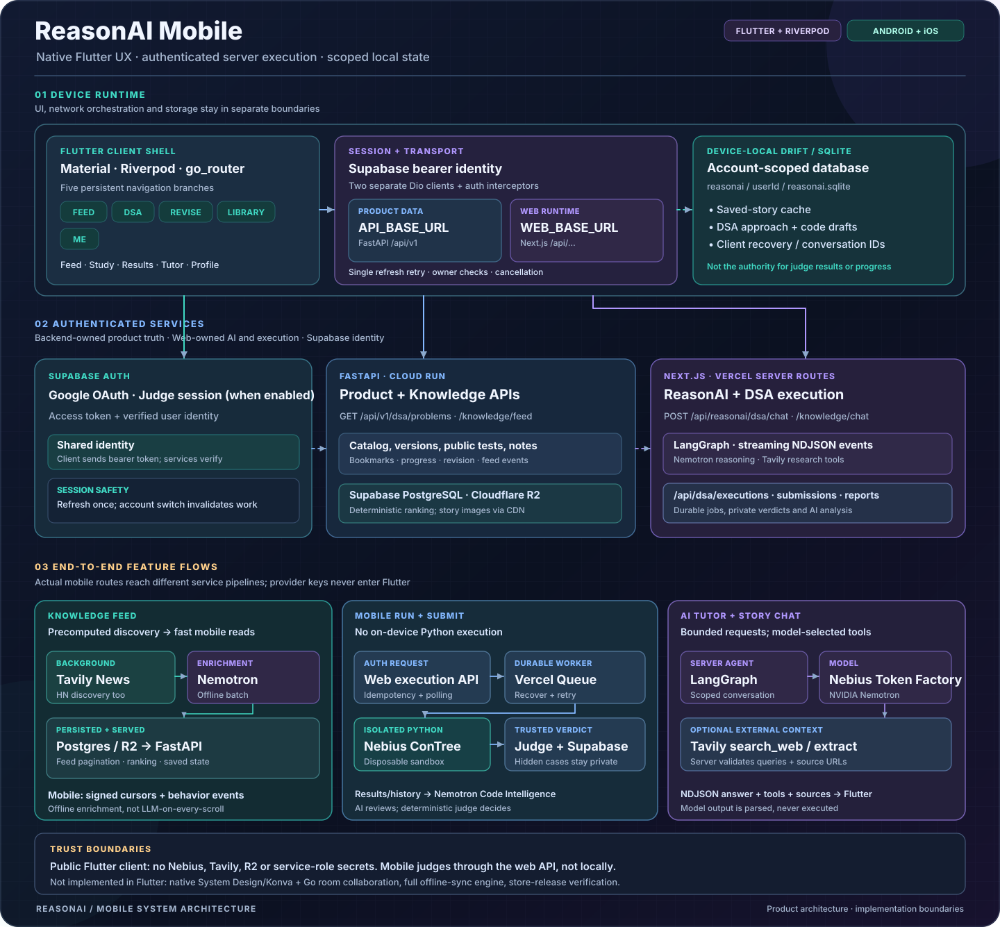
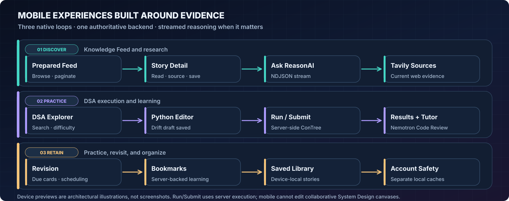

# ReasonAI Mobile

<p align="center">
  <strong>Build Better Engineering Judgment — Wherever You Learn.</strong>
</p>

<p align="center">
  <strong>Discover. Practice. Review. Improve.</strong><br/>
  A native Flutter experience for learning from current engineering knowledge, solving real coding problems, and getting evidence-grounded NVIDIA Nemotron guidance on Nebius.
</p>

<p align="center">
  <a href="https://www.reasonai.tech/login"><strong>Explore ReasonAI</strong></a> &nbsp;·&nbsp;
  <a href="docs/device-smoke-checklist.md"><strong>Android Testing</strong></a> &nbsp;·&nbsp;
  <a href="docs/release-readiness.md">Release Readiness</a> &nbsp;·&nbsp;
  <a href="docs/ENGINEERING_REFERENCE.md">Engineering Deep Dive</a>
</p>

---

### Designed for mobile. Connected to the same trusted engineering backend.



**Flutter owns the experience. FastAPI owns the learning data. Next.js owns interactive AI and judging.**

The app deliberately separates **device-local drafts and caches** from **server-authoritative progress, submissions, verdicts and AI conversations**. Supabase Auth protects both authenticated Dio clients; Nebius, Tavily, private test cases and service credentials remain server-side.

<details>
<summary><strong>Explore the complete mobile architecture and trust boundaries</strong></summary>



[Full mobile engineering reference →](docs/ENGINEERING_REFERENCE.md) · [Web architecture →](../web/README.md) · [Backend architecture →](../backend/README.md)
</details>

## Three native workflows: learn, prove, retain



### 01 · Discover engineering knowledge

**Prepared Knowledge Feed → Story → Ask ReasonAI → Sources.** Browse paginated technical stories, open their original sources, save relevant material, and ask follow-up questions. Feed cards are prepared through offline Tavily discovery and Nemotron enrichment, then delivered by **FastAPI** without an LLM call on each scroll. Interactive story chat uses **Next.js**, streamed ReasonAI responses, and bounded Tavily research where fresh facts matter.

### 02 · Practice with server-backed evidence

**DSA Explorer → Native Python editor → Run / Submit → Results & Code Intelligence.** Search the canonical problem catalog; filter by difficulty, category, and company; edit code with mobile-friendly controls; and return to account- and version-scoped drafts.

On mobile, **both Run and Submit call authenticated server execution APIs**. Unlike the web, Flutter **does not run Pyodide locally**. The web execution infrastructure dispatches sandbox work to **Nebius ConTree**, where deterministic judging determines the result. Saved submissions, history, and **Nemotron Super Code Intelligence** are retrieved from the existing platform.

**A public Run passing is not an official Accepted verdict.** The app distinguishes a provisional pass (`provisional_pass`) from an officially certified acceptance.

### 03 · Return and improve

**Revision → Bookmarks → Library → Me.** Review scheduled concepts, maintain server-backed learning progress and bookmarks, find previously encountered saved stories, and manage profile/preferences. **Drift + SQLite** protects local code drafts and device-specific saved-story cache without pretending to replace the canonical backend.

---

## What ships in the Flutter client

| Mobile capability | Implementation |
| --- | --- |
| **Five navigation branches** | Feed · DSA · Revise · Library · Me, with GoRouter and Riverpod-managed UI state |
| **Authentication** | Supabase Google OAuth, session refresh and optional hackathon judge sign-in when configured |
| **DSA** | Published explorer, native Python editor, authenticated Run/Submit, history, saved submissions, Code Intelligence and contextual Nemotron tutoring |
| **Ask ReasonAI** | Authenticated streaming **NDJSON**, incremental text, tools, sources, visual lessons and run lifecycle handling |
| **Knowledge Feed** | Deterministic feed serving, story reading, interaction events, saving, personalized content and on-demand research |
| **Revision & Library** | Due reviews, server-backed bookmarks/notes, device-local saved-story cache and search |
| **Local persistence** | Per-account Drift/SQLite drafts, saved-story metadata and recovery records |
| **Security & reliability** | Bearer auth, bounded retry, interrupted-stream handling, cancellation, idempotency and account boundary reset |

**Platform boundary:** The **Konva System Design canvas, AI canvas proposal application and Go WebSocket Live Share are web-only**. The mobile client is a deliberately focused learning product, not a smaller copy of the full web workspace.

<details>
<summary><strong>How the Flutter app communicates with ReasonAI</strong></summary>

| Path | Authority and protocol |
| --- | --- |
| **Flutter → FastAPI** | Dio with Supabase bearer token. DSA catalog, progress, feed, notes, bookmarks, revision and preferences from `API_BASE_URL` ending in `/api/v1`. |
| **Flutter → Next.js** | Separate authenticated Dio client. DSA/Knowledge ReasonAI chat, execution endpoints, submission history and reports under `WEB_BASE_URL`. |
| **Next.js → Nebius Token Factory** | Server-side NVIDIA Nemotron inference and structured AI outputs. |
| **Next.js → Tavily** | Server-owned search tools for timely public sources; offline feed enrichment is a different workflow. |
| **Next.js → Vercel Queue → Nebius ConTree** | Disposable Python sandbox execution, trusted judging and authoritative verdict persistence. |
| **Flutter → Drift** | Per-account cache and drafts only; no mobile-side hidden test oracle or provider credentials. |

Mobile NDJSON events are checked against run ID and sequence number, with interruption and cancellation handling; source citations and structured lessons are parsed rather than treated as executable code.

[API clients](lib/core/api/api_client.dart) · [Streaming client](lib/core/reasonai/reasonai_client.dart) · [DSA API contract](lib/features/dsa/canonical_api.dart) · [Local database](lib/core/db/app_database.dart)
</details>

## Run the mobile app locally

**Prerequisites:** Flutter compatible with **Dart 3.8.1** (reference candidate: Flutter 3.32.5), Android SDK/device or emulator, and access to the existing ReasonAI services. iOS builds require macOS and Xcode.

**1. Clone and configure** (Bash / Git Bash):

```bash
git clone https://github.com/saksham60/recallstack.git && cd recallstack/mobile && cp .env.example .env
```

Fill in `mobile/.env` with client-safe configuration only:

| Variable | Meaning |
| --- | --- |
| `API_BASE_URL` | FastAPI base URL **including `/api/v1`**; Android emulator uses `http://10.0.2.2:8080/api/v1` for a backend running on the host. |
| `WEB_BASE_URL` | Next.js web origin, e.g. `https://www.reasonai.tech` (not a path ending in `/api/v1`). |
| `SUPABASE_URL` | The Supabase project used by the configured APIs. |
| `SUPABASE_ANON_KEY` | Its **public** publishable/anon key. Never a service-role key. |
| `HACKATHON_JUDGE_MODE` | `false` normally; optional judge flow requires matching Supabase configuration. |

**2. Install, generate, run:**

```bash
flutter pub get
dart run build_runner build --delete-conflicting-outputs
flutter run
```

**3. Verify the candidate:**

```bash
dart format --output=none --set-exit-if-changed .
flutter analyze
flutter test
flutter build apk --debug
```

A debug APK is for **device testing**, not Play Store distribution. For reproducible production-configured builds, use the [build-define preparation and release procedures](docs/release-readiness.md); do not embed provider secrets or signing keys in Flutter.

## Build and release boundaries

| Target | What is verified | What remains |
| --- | --- | --- |
| **Android** | An Android debug APK was built, inspected, installed and launched on an emulator; unit/widget tests and mocked UI workflow checks have passing evidence. | A **production-signed APK/AAB** requires the existing release keystore/`android/key.properties` and real-device OAuth, Run/Submit and report checks. |
| **iOS** | CI has demonstrated an unsigned iOS compilation on macOS. | Apple signing, provisioning, export and a real iPhone acceptance test are separate release gates. |
| **Cross-device state** | Server-owned learner records follow authenticated account identity; device-local caches are partitioned per user. | Saved-story Library is **not a complete cross-device list**; full offline catalog, mutation queue and device sync are **not** implemented in Flutter. |

**Release evidence is more important than a “release-ready” badge.** The mobile README documents implemented capabilities; an app-store release is not claimed until signing and live end-to-end gates pass.

[Detailed release checklist →](docs/release-readiness.md) · [Device smoke tests →](docs/device-smoke-checklist.md)

## Explore the code and engineering evidence

| What to inspect | Source |
| --- | --- |
| **Navigation and guarded session flow** | [GoRouter app shell](lib/app/router.dart) · [Supabase authentication](lib/core/auth/auth_repository.dart) |
| **Canonical DSA catalog and execution** | [Mobile DSA API](lib/features/dsa/canonical_api.dart) · [Web ConTree adapter](../web/src/lib/dsa-execution/contree.ts) |
| **AI streaming and recovery** | [ReasonAI NDJSON client](lib/core/reasonai/reasonai_client.dart) · [Full mobile engineering reference](docs/ENGINEERING_REFERENCE.md) |
| **Local account isolation** | [Drift database](lib/core/db/app_database.dart) |
| **Feed discovery and deterministic reads** | [Knowledge pipeline](../backend/docs/knowledge-shorts.md) |
| **Testing, packaging and platform gates** | [Mobile release-readiness evidence](docs/release-readiness.md) · [Device checklist](docs/device-smoke-checklist.md) |
| **Detailed service and trust boundaries** | [Full mobile architecture](docs/assets/reasonai-mobile-architecture.svg) |

---

**ReasonAI Mobile — Learn from evidence, wherever you are.** [Live ReasonAI](https://www.reasonai.tech/login) · [Main README](../README.md) · [Mobile engineering reference](docs/ENGINEERING_REFERENCE.md) · [MIT License](../LICENSE)
