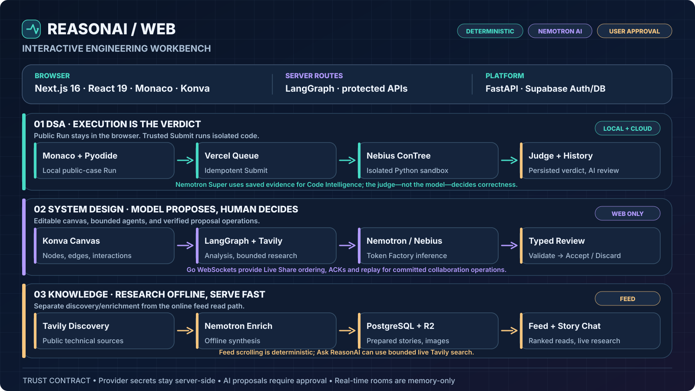
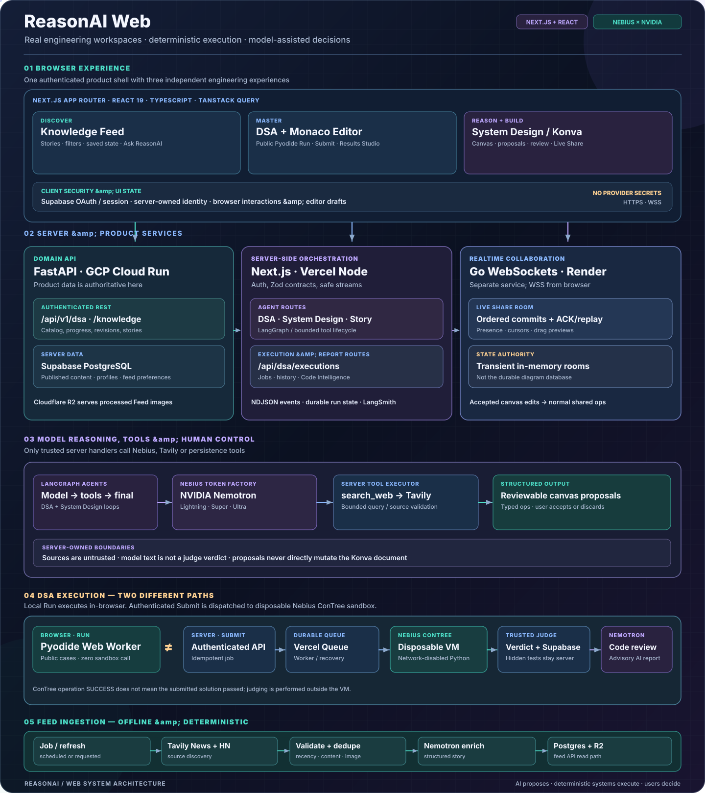
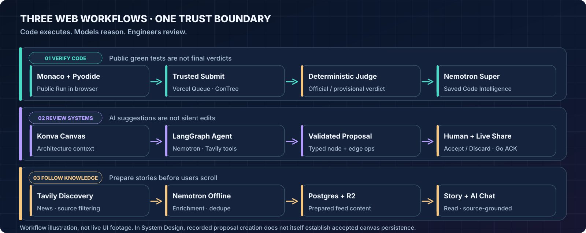

# ReasonAI Web

<p align="center">
  <strong>Build Better Engineering Judgment — In the Browser.</strong>
</p>

<p align="center">
  <strong>Run the code. Stress the design. Review the evidence.</strong><br/>
  An interactive engineering workbench combining Monaco and Pyodide, a multiplayer Konva architecture canvas, trusted sandbox judging, and NVIDIA Nemotron reasoning through Nebius.
</p>

<p align="center">
  <a href="https://www.reasonai.tech/login"><strong>Launch ReasonAI · Judge Access</strong></a> &nbsp;·&nbsp;
  <a href="https://www.youtube.com/watch?v=FoV2KkK72Xs"><strong>Watch the Demo</strong></a> &nbsp;·&nbsp;
  <a href="https://devpost.com/software/reasonai">Devpost</a> &nbsp;·&nbsp;
  <a href="docs/ENGINEERING_REFERENCE.md">Engineering Deep Dive</a>
</p>

---

### A browser experience backed by real execution and reviewable AI.

<picture>
  <source media="(max-width: 767px)" srcset="docs/assets/reasonai-web-overview-mobile.svg">
  
</picture>

**The browser owns interaction. Next.js owns protected AI and execution APIs. FastAPI owns product data. Go owns live collaboration.**

This is **not a prompt wrapper**. **Pyodide** executes local public tests; **Nebius ConTree** executes sandboxed submissions; **deterministic judging** produces the authoritative verdict. **Nemotron via Nebius Token Factory** reasons over the resulting evidence and offers architecture analysis or reviewable canvas operations. The **engineer accepts or discards** proposed changes.

<details>
<summary><strong>Inspect the full web architecture and its service boundaries</strong></summary>



[Open the full-resolution architecture SVG →](docs/assets/reasonai-web-architecture.svg)

[Complete web engineering reference →](docs/ENGINEERING_REFERENCE.md) · [Cross-service architecture →](../docs/ARCHITECTURE.md) · [Backend →](../backend/README.md) · [Realtime →](../realtime/README.md)
</details>

## Three engineering workflows, one consistent trust model

<picture>
  <source media="(max-width: 767px)" srcset="docs/assets/reasonai-web-workflows-mobile.svg">
  
</picture>

### 01 · Verify code, don't guess correctness

**DSA Explorer → Monaco Editor → Pyodide Run → Nebius ConTree Submit → Results Studio → Nemotron Code Intelligence.**

The web editor uses a **Pyodide Web Worker** to run public Python tests locally, giving immediate feedback without hosting a separate inference request. For a trusted Submit, the web API persists an idempotent job; **Vercel Queue** dispatches isolated execution through **Nebius ConTree**, and the **deterministic judge** produces a saved verdict. **Nemotron Super** analyzes permitted submission evidence afterward; it does not grade hidden cases.

**Recorded result:** An overfitted **3Sum** implementation passed **9/9 public cases**, then returned **`wrong_answer`** on a real sandbox submission. The saved Code Intelligence report was associated with that submission.

[Inspect the real DSA evidence →](../docs/dsa-v3/integration-20261017.md) · [Execution API and judging contract →](docs/dsa-executions.md)

### 02 · Turn architectural reasoning into a controlled change

**Konva Canvas → LangGraph Analysis → NVIDIA Nemotron → Typed Proposal → Accept / Discard → Go Live Share.**

Draw with the React/Konva canvas, explore performance and failure scenarios, and call bounded **Tavily `search_web`** when public vendor or architecture facts may have changed. Nemotron can return semantic analysis overlays or a proposed set of node/edge operations; the server validates the structure before the user reviews it. Accepted canvas operations use normal application mutation paths. A **separate Go WebSocket service** orders collaborative committed operations and supports ACK/replay.

**Recorded result:** A production System Design run produced a **pending nine-operation proposal** (five nodes and four edges). This verifies **proposal generation and pending-state persistence**, not a recorded end-to-end Accept-and-reload sequence.

[Production proposal evidence →](../docs/evidence/runs/2026-10-11/SD-LIVE-01/record.md) · [Typed proposal and recovery contract →](docs/reasonai-proposal-recovery.md) · [Realtime architecture →](../realtime/README.md)

### 03 · Read current knowledge without generating every feed card

**Tavily Discovery → Offline Nemotron Enrichment → PostgreSQL / Cloudflare R2 → Deterministic Feed → Ask ReasonAI.**

Knowledge stories are discovered, deduplicated and enriched **offline**; FastAPI serves prepared stories with deterministic ranking and event recording. Story chat is a separate authenticated AI surface and can request bounded live research when current facts are material. The ordinary feed scroll path does **not** make a model inference call per card.

[Knowledge pipeline →](../backend/docs/knowledge-shorts.md) · [Web feed implementation →](docs/knowledge-feed.md)

---

## What makes the web workbench different?

| Product surface | Browser behavior | Authority / reasoning |
| --- | --- | --- |
| **DSA Studio** | Monaco editor, problem filters, local Run, hidden-case Submit, results, history and progressive tutoring | Pyodide for public Run; ConTree sandbox + deterministic judge for Submit; Nemotron for tutoring/reports |
| **System Design** | Konva canvas, analysis overlays, typed diffs, human approval, Live Share | LangGraph + Nemotron + Tavily for reasoning; validated application operations; Go collaboration |
| **Knowledge Feed** | Infinite scroll, source stories, personalization, saved items, follow-up chat | FastAPI prepared/ranked feed; offline Tavily/Nemotron enrichment; live search for relevant chat |
| **Learning & persistence** | Authenticated progress, submissions, durable AI context and retry-safe interactions | Supabase Auth, PostgreSQL, bounded conversations, idempotent work orchestration |
| **Admin & diagnostics** | Authenticated dashboards and controlled admin operations | FastAPI authorization, server-side activity/telemetry, optional LangSmith traces |

**Safety model:** Browser code never receives Nebius, Tavily, ConTree, Supabase service-role, or private judging credentials. An AI-generated proposal cannot silently overwrite a shared canvas; model-reported facts are not a substitute for deterministic judge results.

<details>
<summary><strong>View the exact Nemotron tier routing and tool safeguards</strong></summary>

**Nebius Token Factory** serves Nemotron inference from protected Next.js routes. **ConTree Sandbox** is a separate code-execution service.

| Tier / tool | Implemented selection or constraint |
| --- | --- |
| **Nemotron Lightning** · `nvidia/Nemotron-3_5-Lightning` | Explicit `modelPreference = "lightning"` in System Design. Auto never selects Lightning. |
| **Nemotron Super** · `nvidia/nemotron-3-super-120b-a12b` | Default tier for System Design Auto, DSA tutoring/Code Intelligence, and Knowledge reasoning. |
| **Nemotron Ultra** · `nvidia/Nemotron-3-Ultra-550b-a55b` | Explicit `"ultra"` or a single valid model-requested Auto escalation from Super. |
| **Auto: Super → Ultra** | Only at `toolRounds === 0` with preference `"auto"`, tier `"super"`, no required canvas proposal and no prior escalation. The model must call `escalate_reasoning` alone with one allowed reason: `architecture_tradeoff`, `conflicting_constraints`, `deep_reliability`, or `complex_synthesis`. The server validates the request. |
| **System Design Tavily** | Up to 2 searches per turn, 3 results per request, 6 deduplicated evidence records, and a 7-second Tavily deadline. |
| **Agent bounds** | Maximum 4 tool rounds, 15-second tool timeout, 8,192 requested output tokens per model round, equivalent repeated calls rejected, one missing-proposal retry and one proposal-validation repair. |
| **Context bounds** | At most 6 recent System Design turns and a 4,000-character summary; proposal state is separate from committed canvas document state. |

[Source: tier selection](src/features/system-design/reasonai/model-registry.ts) · [LangGraph agent](src/lib/reasonai/server/langgraph/system-design/nodes/agent.ts) · [Validated tools](src/lib/reasonai/server/langgraph/system-design/tools.ts) · [Tavily search](src/lib/tavily/search.ts)
</details>

## Judge walkthrough

**[Open the hosted workbench](https://www.reasonai.tech/login)** and select **Continue as Hackathon Judge**.

1. **System Design:** Request a single-point-of-failure review. Inspect the node/edge references and any generated proposal before choosing **Accept** or **Discard**.
2. **DSA:** Open **3Sum**. Use the local public-test **Run**, then **Submit** to inspect the server verdict, history and Code Intelligence report.
3. **Collaboration:** Share a System Design canvas across two browser sessions and inspect ordered edits and reconnect behavior.
4. **Knowledge:** Open a story and ask for current related research to observe cited Tavily evidence where the agent uses live search.

**Suggested System Design prompt:** `Review this architecture for a single point of failure. Identify affected nodes and propose reviewable changes.`

[Product demo →](https://www.youtube.com/watch?v=FoV2KkK72Xs)

---

## Local development

**Prerequisites:** Node.js **22+**, npm, a configured Supabase Auth/DB project, access to the FastAPI domain backend, and a separate Go service for Live Share. Live Nemotron/Tavily and ConTree Submit require server-side credentials. The web application runs on **Next.js 16**, not Vite.

**1. Clone and create local configuration** (Bash / Git Bash):

```bash
git clone https://github.com/saksham60/recallstack.git && cd recallstack/web && cp .env.example .env.local
```

Fill in `web/.env.local` before running the app:

| Variable | Local role |
| --- | --- |
| `NEXT_PUBLIC_API_BASE_URL` | FastAPI origin, e.g. `http://localhost:8080` |
| `NEXT_PUBLIC_SUPABASE_URL`, `NEXT_PUBLIC_SUPABASE_ANON_KEY` | Browser-safe identity configuration |
| `NEXT_PUBLIC_REALTIME_BASE_URL` | Go collaboration service, e.g. `http://localhost:8081` |
| `NEBIUS_API_KEY`, `TAVILY_API_KEY` | Server-only inference and research credentials |
| `SYSTEM_DESIGN_ENABLED=1`, `REASONAI_V2_MODE=all` | Enable the intended local web/agent surfaces |

**2. Install and start Next.js:**

```bash
npm ci
npm run dev
```

Open **http://localhost:3000**. FastAPI, Supabase Auth/database, and Go Live Share must be configured separately; web setup alone does not provision external services or migrations.

To exercise actual sandbox Submit, also configure **`DSA_EXECUTIONS_ENABLED=1`**, **`SUPABASE_SERVICE_ROLE_KEY`**, **`CONTREE_PROJECT`**, **`CONTREE_PYTHON_IMAGE`**, and applicable Nebius/queue infrastructure. Apply the required Supabase migrations and verify execution capabilities before relying on Submit.

[Full-stack setup →](../docs/DEVELOPMENT.md) · [Web execution setup →](docs/dsa-executions.md) · [Detailed web engineering reference →](docs/ENGINEERING_REFERENCE.md)

**3. Verify the web package:**

```bash
npm run typecheck
npm run lint
npm run build
npm run test:system-design-state
npm run test:executions
```

Run `npm run verify` for the broader build and Playwright verification sequence when its test dependencies and fixtures are configured. Browser/provider mocks do not prove live external execution or inference availability.

## What remains difficult

| Engineering boundary | Current limitation |
| --- | --- |
| **Model reasoning vs. correct verdicts** | Schema-valid AI analysis does not prove a mathematically valid explanation or a sound capacity estimate. The deterministic judge owns code correctness. |
| **Proposal lifecycle vs. durable diagrams** | The recorded live AI run verifies a persisted **pending** proposal; it does not independently verify user acceptance and a durable standalone canvas after reload. |
| **Realtime vs. durable collaboration** | Go rooms, operation ordering and bounded replay are memory-only and single-instance. Process restarts do not preserve room state; durable diagram persistence is separate. |
| **Offline enrichment vs. live facts** | Prepared Knowledge stories may age between refreshes. On-demand Tavily search is a separate tool path, not a guarantee that every answer is fresh. |
| **Tier escalation vs. measurable intelligence** | Auto gates Super → Ultra tool requests; the model still judges when to escalate. It is not a calibrated complexity classifier or proven quality-per-token optimizer. |

## Inspect the code and evidence

| Engineering claim | Source |
| --- | --- |
| **Next.js execution orchestration and isolated ConTree judging** | [ConTree adapter](src/lib/dsa-execution/contree.ts) · [Queue consumer](src/app/api/queues/dsa-executions/route.ts) · [Execution contract](docs/dsa-executions.md) |
| **Real 3Sum Submit and Nemotron report** | [Production DSA integration evidence](../docs/dsa-v3/integration-20261017.md) |
| **Typed System Design proposals and research** | [Tool implementation](src/lib/reasonai/server/langgraph/system-design/tools.ts) · [Proposal safety guide](docs/reasonai-proposal-recovery.md) |
| **Web collaboration / Go room semantics** | [Realtime service reference](../realtime/README.md) |
| **Knowledge feed and Tavily grounding** | [Feed UI documentation](docs/knowledge-feed.md) · [Server-side Tavily adapter](src/lib/tavily/search.ts) |
| **Auth, durable ReasonAI, memory and deployment** | [Complete web engineering reference](docs/ENGINEERING_REFERENCE.md) |
| **Cross-product architecture** | [Main README](../README.md) · [System architecture](../docs/ARCHITECTURE.md) |

---

**ReasonAI Web — Test your assumptions. Keep the evidence.** [Live app](https://www.reasonai.tech/login) · [Main README](../README.md) · [Mobile](../mobile/README.md) · [MIT License](../LICENSE)
