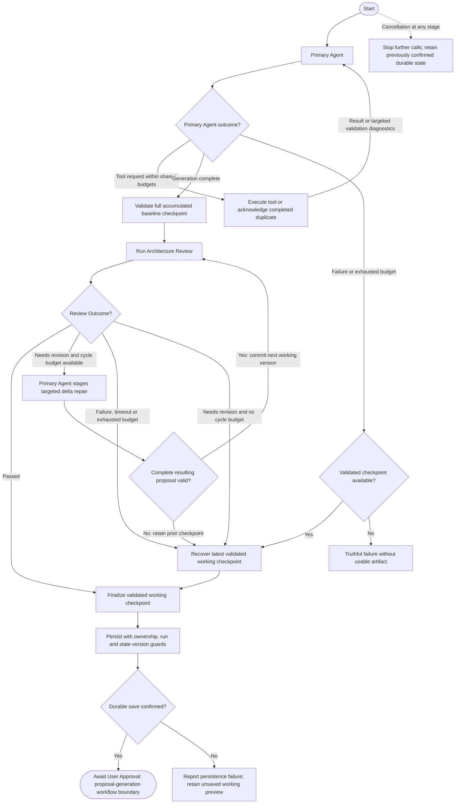

# System Design agent reliability handoff

Implementation and regression coverage added on October 24, 2026. Tests, builds,
type checks, migrations, deployments and pushes were **NOT RUN**. Existing local
edits were preserved. Behavioral acceptance remains unverified until testing.

## Required database handoff

`supabase/legacy-proposals/20261024_reasonai_checkpoint_finalization.sql` is an
**unapplied SQL proposal**, outside migration discovery. Register and apply it
through the normal migration process before testing guarded Supabase completion.
It adds an authenticated, ownership-checked RPC wrapper around the existing
finalizer, with row locks and an expected conversation state version. It adds no
tables and does not change the shared DSA finalizer.

The application deliberately fails completion without a saved confirmation if
this RPC is absent. It never silently falls back to an unguarded state overwrite.
The memory repository implements the same version check for regression coverage.
The database transaction and deployment compatibility have not been executed.

## Confirmed code paths and incident uncertainty

Before this change, a canonical duplicate key threw a provider error before
execution. Failed validation calls were also remembered as executed. A second
validation failure threw, graph finalization required successful model narration,
and graph exceptions did not produce candidate conversation state. The stream
reported all non-cancellation failures as `PROVIDER_FAILURE`. Proposal streaming
and durable finalization also allocated identity independently.

These are code findings, not proof of which path caused each production incident.
The supplied October 24 sequences do not identify the failed payload, upstream
response or network cause. In particular, the 336 ms early failure remains
unexplained. Regression reproductions are synthetic sequences, not captured
production traces.

## Execution flow

Previously: Start → Primary Agent ↔ Tools → successful final narration → Finalize.
An exception could escape before durable candidate state existed.

The graph contains explicit baseline, review and repair nodes. Architecture
review starts only after a final primary generation round. It does not run after
each batch, after truncated generation, or after generation budget recovery.
Layout-only proposals record `not_started` with `layout_only`.

## Shared budgets

All counters belong to one request-scoped `SystemDesignBudget`; valid structural
repairs never reset them. Defaults, configurable through graph/stream execution
options, are:

| Limit | Default |
| --- | --- |
| Total generation + review + repair model calls | 12 |
| Primary generation model calls, including correction/escalation | 6 |
| Primary tool rounds, including duplicate acknowledgments | 4 |
| Duplicate acknowledgments | 2 |
| Structural validation correction attempts | 1 |
| Architecture review iterations across the complete cycle | 2 |
| Delta repair calls across the complete cycle | 2 |
| Request duration, measured from route entry | 120 seconds |
| Reserved persistence and cleanup time | 15 seconds |
| Individual review / delta repair call | 30 / 30 seconds |

No further model call starts after a corresponding budget expires. Review only
starts a delta repair when there is remaining capacity for repair and re-review.
Calls are raced against the shared deadline and cancellation signal, including
providers that fail to cooperate with abort. A separate LangGraph recursion
limit sits above the configured transitions as a secondary bound.

## Checkpoint and review semantics

`pendingProposal` is the previously confirmed durable input. `workingCheckpoint`
is an in-memory validated candidate. `baselineCheckpoint` captures the entire
primary proposal before review. A graph candidate callback is not a database
confirmation.

The checkpoint owns proposal ID, content version, stable operation IDs, diagram
fingerprint and reference mappings. Unchanged operations keep IDs. Changed
operations receive fresh approval identities. Review bookkeeping alone does not
increment the content version. The stream uses checkpoint identity and version.

Review metadata lives inside the existing proposal JSON value; the outer durable
state and pending-proposal SQL allowlists remain unchanged. Metadata is accepted
only for accumulated/acceptance validation; model batches cannot forge a review.
Review status is one of `not_started`, `passed`, `needs_revision`, `incomplete`,
or `failed`. Passing reviews bind to the current version and content fingerprint.
Findings retained after a changed proposal identify their older reviewed version.
No status is a security certification.

Nemotron Ultra reviews the projected existing canvas plus all proposal operations,
original requirements and assumptions. The Primary Agent's selected model handles
delta repair through the same Nebius provider. Neither reviewer nor repair call
can commit a canvas mutation.

Delta edits target a proposal ID, expected version and stable operation IDs.
Removal deletes a proposed operation, not a canvas entity. Additions support
insertion before an existing operation for dependency ordering. Replacement,
removal and insertion occur on a copy. The whole result is strictly validated
before committing the next version. Existing sanitizer safeguards reject a delta
that would drop operations, including duplicate connections. Dangling references or attempts to alter
accepted/dismissed operations reject the delta. Empty proposals remain invalid
under the existing contract; the user can discard an unwanted proposal.

## Recovery, persistence and approval

Duplicate acknowledgment pairs with the new incoming tool-call ID and returns
the previous validated result without another execution or checkpoint version.
Failed calls are not cached as successful completions. The existing serial
one-tool-per-response protocol remains in place.

Generation, review, repair and narration failures recover only when a validated
working checkpoint exists. Operations and content version are preserved exactly;
review/recovery metadata describes unfinished work. Semantic-review exhaustion
retains `needs_revision`; failed/unavailable/timed-out review is never `passed`.
Without a checkpoint, the run fails truthfully. Cancellation stops the workflow
without promoting a new working proposal to durable state.

Completed runs save through the guarded RPC. The expected state version is read
at request preparation; the RPC compares it under row locks and preserves
terminal single-winner semantics. Existing active-run approval guards remain.
An older recovery cannot overwrite newer acceptance or dismissal decisions.

`artifact.proposal` identifies a working preview. `artifact.persistence` confirms
the matching proposal ID/version only after database finalization succeeds. A
failed save, stale version or a cancellation winning finalization emits failure
without saved confirmation or successful completion. The existing cards remain
disabled until saving is confirmed; restored pending proposals come from durable
state. Existing acceptance, discard, Undo and Live Share commit paths are reused.

System Design tracing uses counts, stages, model identity and diagnostic codes.
Provider prompts, conversation contents, full tool results and arguments are
excluded from its new metadata-only tracing path. Shared DSA/Feed callers retain
their previous default tracing/persistence behavior.

## Changed files

| Area | Files |
| --- | --- |
| Review schemas and provider transport | `src/features/system-design/reasonai/{architecture-review,agent-provider,contract,provider}.ts` |
| Identity, metadata and frontend status | `src/features/system-design/reasonai/{proposal-state,runtime-client}.ts`, `ReasonAIPanel.tsx` |
| Graph execution | `src/lib/reasonai/server/langgraph/system-design/{budget,checkpoint,recovery,state,events,graph,tools}.ts`, `nodes/{agent,tools,finalize,review}.ts` |
| Streaming protocol and confirmation | `src/lib/reasonai/server/system-design-stream.ts`, `src/lib/reasonai/runtime/{events,types,protocol,reducer}.ts` |
| Persistence and request deadline | `src/app/api/reasonai/chat/route.ts`, `src/lib/reasonai/server/persistence/{types,stream,memory-repository,supabase-repository}.ts` |
| Sanitized tracing | `src/lib/reasonai/server/langsmith.ts` |
| Unapplied SQL handoff | `supabase/legacy-proposals/20261024_reasonai_checkpoint_finalization.sql` |
| Regression coverage | `e2e/system-design-reasonai-reliability.spec.ts`, `e2e/system-design-reasonai-agent.spec.ts`, `e2e/langsmith.spec.ts`, `playwright.system-design-state.config.ts` |
| Handoff | This document |

## Regression coverage — NOT RUN

The new suite covers global semantic review loops with valid deltas, total model
calls, review/repair caps, shared deadlines and cleanup reserve, full multi-batch
baseline placement, no-checkpoint failures, truncated generation, duplicate ID
pairing/continued reasoning, targeted validation correction, distinct review
outcomes, reviewer timeout, atomic delta dependency checks, stable IDs, rejected
changes to decided operations, stale review fingerprints, narration failure,
cancellation, persistence confirmation/failure, stale finalization, idempotent
terminal retries, real provider request shapes with mocked HTTP, and synthetic
incident sequences. Existing cap tests now require no post-exhaustion model call.
LangSmith coverage adds metadata-only redaction assertions.

The SQL handoff has static contract assertions; these do not establish transaction
behavior on a real database. Run the existing approval, Undo, state and realtime
suites as part of manual verification. No passing result is claimed here.

## Manual testing checklist

1. Register/apply the SQL handoff in a test environment using the normal process.
   Confirm the authenticated RPC is available and rejects another user's IDs.
2. Run `npm run test:system-design-state`, then the existing System Design browser
   and realtime suites. Run type checking, lint and build under your own workflow.
3. Request an Ultra architecture spanning several batches. Confirm review begins
   after primary generation and sees the complete proposed graph.
4. Simulate repeated material findings with structurally valid deltas. Confirm
   calls stop at each configured global limit and unresolved findings remain visible.
5. Simulate primary/review/repair timeout and provider failures. Check that the
   latest validated operations and version survive and no false pass appears.
6. Fail final persistence and create a state-version conflict. Confirm there is
   no saved/awaiting-approval claim, no enabled approval, and no overwritten decisions.
7. Cancel during generation, review, repair and saving. Verify the terminal winner,
   absence of further calls and retention of previously confirmed durable state.
8. Accept, dismiss and discard through the existing controls. Verify Undo and
   Live Share, then check Feed, DSA and authentication regression behavior.
9. Inspect System Design Vercel/LangSmith diagnostics for useful stage/counter
   information without conversation text, secret values or raw tool arguments.

## Limits

The reviewer is advisory and can miss architectural problems. No production logs
were fetched and no production incident cause was proven by execution. Interrupted
processes can lose an unsaved in-memory checkpoint; there is no new background
checkpoint service. The 15-second cleanup reserve cannot guarantee database
availability. Guarded Supabase completion requires the unapplied SQL handoff.
No deployment, migration application, test, type check or build was performed.
